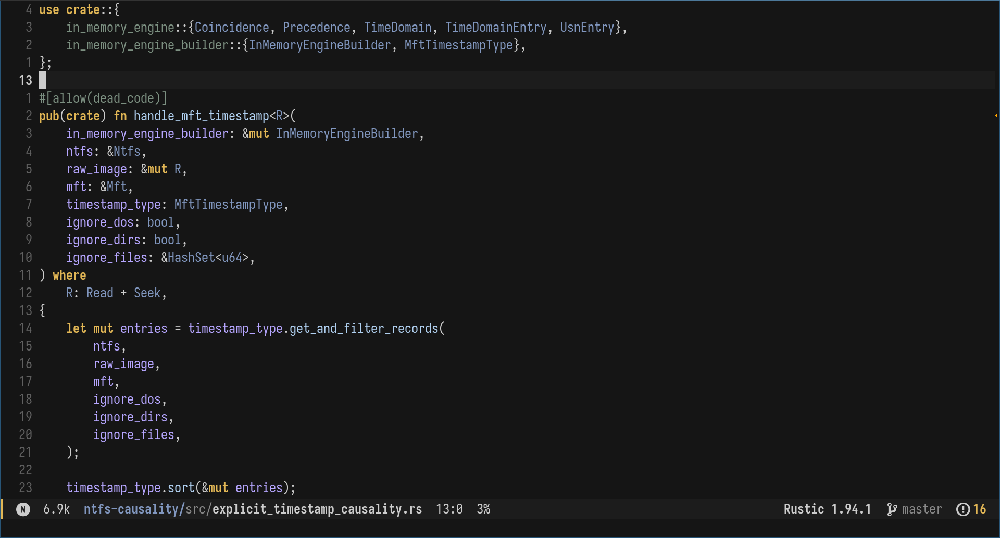
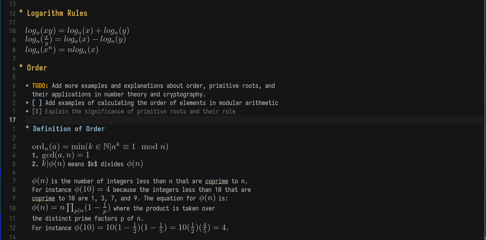

# yellowbeans-theme-emacs

`Yellowbeans` color theme originally created by [gremble0](https://github.com/gremble0/yellowbeans.nvim) ported to Emacs.




## Installation

The package is currently not available in `MELPA`. You have to install it manually.

For vanilla Emacs:
```bash
git clone https://github.com/bvtuhan/yellowbeans-theme-emacs
cp yellowbeans-theme-emacs/yellowbeans-theme.el ~/.emacs.d/themes/
```
```el
(add-to-list 'custom-theme-load-path "~/.emacs.d/themes/")
(load-theme 'yellowbeans t)
```

For Doom Emcas:
```bash
git clone https://github.com/bvtuhan/yellowbeans-theme-emacs
cp yellowbeans-theme-emacs/yellowbeans-theme.el ~/.config/doom/themes/
```
```el
(setq doom-theme 'yellowbeans)
```

## Acknowledgments

For modeling and styling, I used different themes as references, including:

- [gruber-darker](https://github.com/rexim/gruber-darker-theme/blob/master/gruber-darker-theme.el)
- [Zenburn](https://github.com/bbatsov/zenburn-emacs/blob/master/zenburn-theme.el)
- [poet](https://github.com/kunalb/poet/blob/master/poet-dark-theme.el)
- [kaolin](https://github.com/ogdenwebb/emacs-kaolin-themes)

